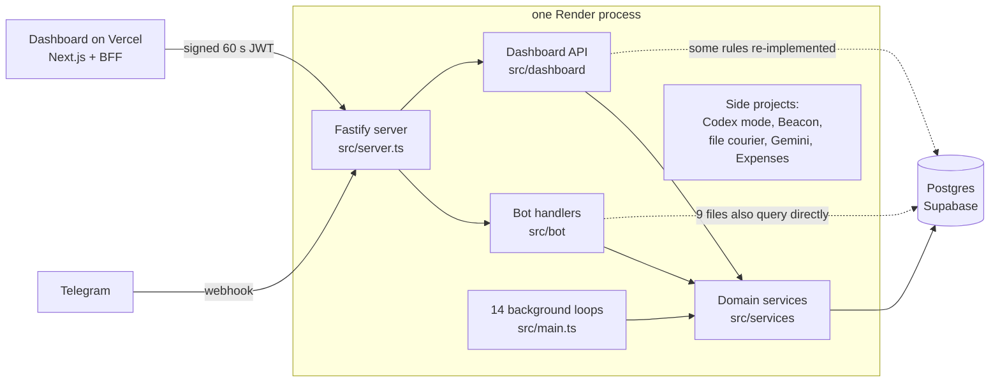
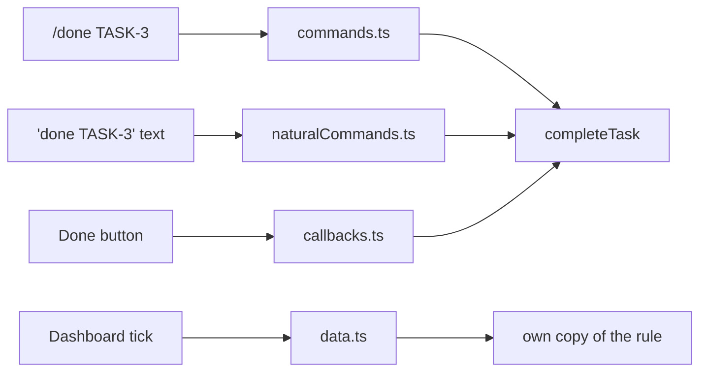

# Threadwise review, 1 November 2026

A read-only review of the backend (`Henry336/threadwise`, `main` at `5dc748a`, v0.35.7) and the dashboard (`Henry336/threadwise-dashboard`, `5ecfe5f`, v0.10.2). No code was changed and no tests were run. Every finding comes from reading the code. The Must-fix bugs were re-checked line by line, but none were reproduced by running anything.

**Scope.** Threadwise the product, meaning Personal mode, Group mode and the dashboard. Study mode is reviewed only where it touches shared code, because it is the owner's private tool. Beacon, Telegram Codex mode, the file courier, Gemini, Expenses/Excel and the Daily Tech Brief are not part of the product. They appear only where they affect Threadwise.

**Load assumed.** One owner plus a few friends' groups. One Render instance running a single Node process, a Supabase free-tier database with a 3-connection pool, and a 5 GB monthly bandwidth allowance. "Breaks at scale" here means breaks at this load, not at thousands of users.

**How to read this.** Section 1 gives the verdict. Section 2 explains how the system is built, top-down. Sections 3 to 7 cover the code: findings, defensiveness, tests, patterns and principles. Section 8 covers the docs, and section 9 the product. Section 10 is a suggested order of work. Finding numbers (#1 to #20) and test numbers (T1, G1) are referenced across sections.

---

## 1. Verdict

- **The code works and is mostly careful.** Security at the edges is good: webhook secret, signed dashboard tokens, replay protection, sanitized Markdown, sealed Study mode. The bandwidth fixes held.
- **It has a handful of real bugs that users can hit.** A recurring task can skip an occurrence (#1). Completing a task from the dashboard follows different rules than completing it from Telegram (#2). Escape can close a note editor too eagerly (#3). Any group member can undo anyone's change (#4). A frozen feature still captures ordinary messages (#5). One database blip can crash the whole process (#6).
- **The main maintainability problem is copies, not size.** The same action is written three or four times: once each for slash commands, natural text, buttons and the dashboard. The copies have started to disagree, and that is where most of the bugs above came from.
- **The defensiveness is in the wrong places.** There are many internal re-checks that TypeScript and zod already guarantee (81 copies of `settings?.timezone ?? "UTC"`), and a database write on every request. Meanwhile some real gaps sit unguarded: undo in groups, AI output parsing, loop crashes.
- **The tests are not bloated by volume** (about 1 test line per 4 source lines). They are aimed at the wrong things: exact wording and fake-database call shapes. No test uses the real database that CI already starts.
- **The product is four products in one process**, with Personal and Group about half the backend. Section 9 covers what that means.

**Fix first:** #1 to #6, each a small change plus one test. They make good first tasks for you to implement yourself (section 10).

---

## 2. How Threadwise is built (top-down)

### 2.1 Black box

People send messages, photos and voice notes to `@threadwise_1_bot` in a private chat or a group. Threadwise turns them into tasks, reminders, notes and ideas, reminds people at the right time, and shows everything in a web dashboard. It works without a paid AI API: rules handle the obvious cases, and AI is optional.

### 2.2 The parts

| Part | Job | Size |
|---|---|---|
| `src/bot/` | Turn Telegram updates into calls to services, and turn results back into messages and buttons | 18,100 lines |
| `src/services/` | Domain rules: tasks, reminders, notes, undo, groups, Study | the largest folder |
| `src/dashboard/` | HTTP API for the dashboard: auth, rate limit, workspace scoping, mapping rows to view objects | about 6,000 lines |
| `src/security/` | Field encryption, replay protection, rate limiting | small |
| `src/ai/` | Optional AI behind one interface, with a deterministic fallback | small |
| `prisma/schema.prisma` | 108 tables from 72 migrations | 2,972 lines |
| Dashboard repo | Next.js app. A server route (the "BFF", backend for frontend) signs tokens and forwards an allowlist of calls | about 11,200 lines |

### 2.3 How they work together

1. A Telegram update arrives at the webhook. The server checks the secret, applies the rate limit and records the update id so a retry is not processed twice.
2. grammY passes the update down a chain of handlers. Each one checks whether the message is "for it" (an open Today draft, a note session, Study, a pending edit). If not, it calls `next()`.
3. The natural-language handler tries about 45 regex rules in order. The first match calls a service, such as `createTask`.
4. The service writes to Postgres inside a transaction and records an undo entry in `AuditLog`.
5. The handler formats a reply card with at most three buttons. A button's `callback_data` is a short string such as `task:done:<id>`, routed by regex in `src/bot/callbacks.ts`.
6. Background loops wake every minute or so to send due reminders, expire drafts, process image albums and sync Canvas.
7. The dashboard reads one snapshot per workspace and polls a revision number. When it changes, the dashboard refreshes.

---

## 3. Findings

Numbered across all groups so you can say "fix 2 and 5". Twenty are listed. Twenty-six smaller ones are in Appendix B.

### Must fix (bugs users can hit)

**1. Completing a recurring task twice skips an occurrence** ([src/services/tasks.ts:229-254](src/services/tasks.ts:229))
- **What this is:** Done on a recurring task keeps it open and moves `dueAt` to the next occurrence.
- **Problem:** Unlike the one-off path below it, the recurring path has no guard. `nextRecurringDueAt` always moves at least one step forward. Take "Water plants daily 19:00": you tap Done today, then tap Done again on yesterday's reminder card, or double-tap. The due date jumps from tomorrow to the day after, and tomorrow is silently skipped. The dashboard's copy (`src/dashboard/data.ts:563`) has the same flaw.
- **Fix:** Put the occurrence's due time in the Done button. Only advance with `updateMany({ where: { id, dueAt: shownDueAt } })`; if nothing changed, reply "Already done". Text commands keep today's behaviour. About 10 lines plus test G1.
- **If we skip it:** Recurring reminders quietly lose occurrences. People stop trusting them and do not know why.

**2. The dashboard completes tasks with its own, older rules** ([src/dashboard/data.ts:563-606](src/dashboard/data.ts:563))
- **What this is:** Ticking a task in the dashboard sends a PATCH. `updateDashboardTask` then rewrites the task itself instead of calling `completeTask`.
- **Problem:** The Telegram version resets `remindersDismissedAt`, `automaticReminderCount` and `undatedNudgeCount` when a recurring task rolls over. The dashboard version does not, and the reminder query skips any task with `remindersDismissedAt` set (`src/services/reminders.ts:118`). Dismiss reminders on this week's "Weekly report", then tick it in the dashboard, and next week's occurrence never reminds you. Ticking it in Telegram works correctly.
- **Fix:** Send status changes to `completeTask`, `restoreCompletedTask` and `cancelTask`. Deleting the copy saves about 45 lines, and it also fixes #1 for the dashboard.
- **If we skip it:** The same button behaves differently depending on where you press it.

**3. Escape closes the whole note editor, even when you only meant to close a sheet inside it** (`threadwise-dashboard/src/components/dashboard-app.tsx:416`)
- **What this is:** A window-level shortcut handler. On Escape it calls `setEditor(null)` and closes everything, with no check for whether you are typing.
- **Problem:** The note editor's own Escape handler (`personal-note-editor.tsx:180`) runs first and asks to close safely, after saving. Then the window handler unmounts the editor anyway. Pressing Escape to cancel the "Save note" sheet closes the whole editor. If the last autosave failed, for example offline, the text typed since then is gone.
- **Fix:** Drop `setEditor(null)` from the global Escape branch (every modal already handles its own Escape), or add `if (event.defaultPrevented) return;`. One line, plus one Playwright step to confirm.
- **If we skip it:** Occasional lost note text, which is the failure you hated most in August.

**4. Any group member can undo anyone's last change** ([src/bot/commands.ts:599-602](src/bot/commands.ts:599), [src/services/undo.ts:223](src/services/undo.ts:223))
- **What this is:** In a group, `/undo` (and "undo that") reverses the newest undo entry of the group's shared owner `chat:<id>`.
- **Problem:** It does not check who made the change, or whether the person undoing may make it. The group policy says only a manager or the assignee may complete a task ([src/services/groupTaskPolicy.ts:76](src/services/groupTaskPolicy.ts:76)). Yet any member can `/undo` someone else's completion and reopen the task, or undo a creation and archive it.
- **Fix:** Store `actorTelegramId` in the undo entry (already available as `CollaborationActor`). In groups, only undo entries whose actor is the person asking, or let managers undo anything.
- **If we skip it:** The rules you designed for Group mode can be bypassed with one command.

**5. The frozen Expenses feature still captures ordinary messages** ([src/bot/naturalCommands.ts:262](src/bot/naturalCommands.ts:262), [:940](src/bot/naturalCommands.ts:940))
- **What this is:** Expenses and Excel are "retained but hidden". The rule `/^(i )?(spent|paid) .+/` still runs, ungated, for every Personal and Group message.
- **Problem:** "paid the electricity bill" or "spent 2 hours on the essay" goes to the expense parser, not to the review card. The user gets an expense prompt or "I couldn't prepare that expense". Every text message also queries `pendingExpense`.
- **Fix:** Delete the expense, Excel and Microsoft branches from the bot layer (about 400 lines). Keep the services and tables if you want the data. If you want the feature back later, git has it.
- **If we skip it:** A hidden feature breaks a visible one.

**6. One database blip can crash the whole process** ([src/bot/dailyBriefs.ts:129-137](src/bot/dailyBriefs.ts:129), [src/main.ts](src/main.ts))
- **What this is:** 14 background loops, each started its own way. Some ticks use `try/finally` with no `catch`.
- **Problem:** If the candidate query in the daily brief pass throws (a Supabase hiccup, which happened on 18 August), the promise rejects with nobody handling it. Node 22 then exits the process, and there is no `unhandledRejection` handler. Render restarts it, but every user is offline for that time and in-memory state such as open menu inputs is lost. The loops also use three different "only one at a time" styles, and shutdown is 14 lines of `clearInterval`.
- **Fix:** One `startLoop(name, ms, fn)` helper that catches and logs, runs one tick at a time, calls `unref` and returns a stop function. `main.ts` becomes a list. About 30 lines added, about 40 removed.
- **If we skip it:** Rare but total outages, with only a crash log to go on.

### Should fix (duplication, waste, missing tests, wrong-sized code)

**7. Every task action is written three or four times** (`src/bot/commands.ts`, `src/bot/naturalCommands.ts`, `src/bot/callbacks.ts`, `src/dashboard/data.ts`)

- **What this is:** Complete, snooze, cancel, assign and delete each have a copy per entry point, with their own group-policy wrapper and their own reply text.
- **Problem:** The copies have drifted. A button says "Already complete" while the text command uses `formatTaskAlreadyCompleted`. There are three wrappers around `assertGroupTaskAction`. Task creation is hand-assembled 15 times: one reviewer found the review-card save path drops mentions that `/add` keeps (not reproduced).
- **Fix:** The Command pattern (section 6.3). Each entry point only parses input into `{ action, ref, actor }`, and one executor runs the policy, the service, the group activity log and the reply. About 250 lines saved, and #1, #2 and #4 cannot recur.
- **If we skip it:** Every rule change has to be made in three or four places, and one will be missed.

**8. Reminder delivery is written four times, and failures retry forever** ([src/services/reminders.ts:166-624](src/services/reminders.ts:166), [src/services/taskReminderSchedules.ts:157](src/services/taskReminderSchedules.ts:157))
- **What this is:** Four delivery paths (custom times, due nudges, undated nudges, group digests). Each repeats quiet hours, the daily cap, chat lookup, send, ledger write and old-message cleanup.
- **Problem:** Only the first path has the `BUTTON_TYPE_INVALID` fallback that stopped the September egress loop. `attemptCount` is incremented but never read, so a reminder to a group that removed the bot is retried every 15 minutes forever. Four exported functions have no callers anywhere, including tests.
- **Fix:** One `deliverReminder(task, policy)` with a retry cap. `src/services/studyCalendar.ts:297` already has a cap and backoff to copy. Delete the dead functions. About 200 lines saved.
- **If we skip it:** The next bandwidth surprise starts here.

**9. A database write on every request, in a single-process app**
- **What this is:**
  - The "shared" rate limiter upserts a Postgres row on every Telegram update and dashboard call ([src/server.ts:822](src/server.ts:822), `src/security/sharedRateLimit.ts:43`).
  - Every dashboard mutation also inserts a replay row.
  - Group requests upsert membership each time.
  - The BFF makes an extra backend call to check the browser session before each request, including every image.
  - `ensureUser` runs two or three times per message.
- **Problem:** At this load the limits never trigger, but the writes always happen, on a 3-connection pool with metered bandwidth. A 50-image grid in the dashboard costs 50 extra session checks.
- **Fix:**
  - Keep the rate-limit rules, but keep the counters in memory. Add a `shortcut:` comment: in-memory limits only work with one instance, so move them back to Postgres if you ever run two.
  - Carry the session id inside the 60 s JWT and check it once inside `run`.
  - Upsert membership only when the role changes.
  - Pass `user` down instead of calling `ensureUser` again.
- **If we skip it:** Steady database load that does nothing, in a project that has already paid for egress once.

**10. Stored "embeddings" are a recomputable word hash, and editing clears them** ([src/ai/openaiProvider.ts:191](src/ai/openaiProvider.ts:191), [src/services/search.ts:95](src/services/search.ts:95))
- **What this is:** Every task, note and idea stores a 128-number vector. Both AI providers produce it with the same local hash function, not a real embedding.
- **Problem:** Seven edit paths set it to null and nothing recomputes it, so an edited item loses its search score and ranks lower. Every query without a `select` also loads the vector, from the reminder pass to lists to the agenda.
- **Fix:** Compute the hash inside `search.ts` at query time, since it is cheap and gives identical results. Drop the columns and `embed` from `AiProvider`. Also delete `CachedAiProvider`: it caches the fallback result after an OpenAI error until restart, and the multi-model cooldown cannot fix the recorded failure (a 429 quota error on one key). About 150 lines saved.
- **If we skip it:** Search quietly gets worse the more people edit, and the AI layer stays twice as complex as it needs to be.

**11. Assignees are stored twice, and a retired feature is still in the code** (`prisma/schema.prisma:1457`, [src/services/groupCollaboration.ts:37-141](src/services/groupCollaboration.ts:37))
- **What this is:** `Task.assignedTelegramId`, `Username` and `DisplayName` duplicate the `TaskAssignee` table. There are about 62 "if assignees, else the old columns" fallbacks across 9 files. Accept, decline and handoff were retired on 9 August, but their service functions remain and only tests call them.
- **Problem:** The rule that normalizes an assignee key exists three times, with three different fallbacks (`"name:unknown"`, `""`, and a third). Two people can be "the same assignee" in one place and different in another.
- **Fix:** One backfill migration, then drop the columns. Delete the retired functions and their tests. About 130 lines, plus most of the 62 fallbacks.
- **If we skip it:** Group assignment bugs that depend on which copy of the data a screen reads.

**12. `handleNaturalCommand` is one 820-line function, and errors turn into "not found"** ([src/bot/naturalCommands.ts:57-877](src/bot/naturalCommands.ts:57))
- **What this is:** About 45 regex branches in one function. Their order is behaviour: "unassign" at line 597 must come before "cancel" at 620.
- **Problem:**
  - Bare `catch {}` blocks (lines 180, 190, 201, 428-490) turn a database outage into "I couldn't find that note".
  - `src/bot/naturalLanguage.ts:419` decides whether a setting change failed by regex-matching the reply text.
  - Tombstones for features removed in August are still inside (151, 514-536, 577).
- **Fix:**
  - Split by domain into ordered arrays of `{ match, run }` rules.
  - Catch only not-found errors and let `bot.catch` handle the rest.
  - Add one `UserFacingError` class, like the existing `TaskAssignmentError`.
  - Delete the tombstones.
- **If we skip it:** Real outages look like user mistakes, and the file is too long to change safely.

**13. `settings?.timezone ?? "UTC"` appears 81 times, and the defaults disagree** (`src/bot/*`, for example [src/bot/naturalLanguage.ts:95](src/bot/naturalLanguage.ts:95) and [:106](src/bot/naturalLanguage.ts:106))
- **What this is:** `ensureUser` always creates settings (`src/services/users.ts:37-54`), so the `?.` can never be needed.
- **Problem:** The guards protect against nothing, and they disagree. One line falls back to Singapore and the next to UTC. A wrong fallback would show times eight hours off, and the code hides that a broken state was reached.
- **Fix:** Make `ensureUser` return a user with non-null settings, then delete the fallbacks. About 90 lines, almost all deletions.
- **If we skip it:** The textbook example of defence that adds risk instead of removing it.

**14. Production code bends around tests** ([src/dashboard/route.ts:177-278](src/dashboard/route.ts:177), [src/dashboard/data.ts:478](src/dashboard/data.ts:478))
- **What this is:** `DashboardRouteActions` is a 44-entry table of functions, so tests can swap 11 of them. `if (database === prisma)` branches (data.ts lines 478, 695, 713 and 1035, plus snapshot.ts 369) run production side effects only when no test double was passed.
- **Problem:** Production behaviour depends on whether it is under test. That is dependency inversion used backwards: the high-level code knows about its tests. `src/dashboard/studyRoutes.ts` already uses `vi.mock` and does not need this.
- **Fix:** Use `vi.mock` in the tests, then delete the table and the branches. About 100 lines.
- **If we skip it:** A path that runs only in production is a path no test covers.

**15. The view mappers, the file download and the note drafts each exist in several copies**
- **What this is:**
  - `src/dashboard/snapshot.ts:383-475` re-implements `taskView` and `noteView` from `data.ts:275-391`, and the copies have drifted. The snapshot omits `pinned: false` and invents an "Unspecified merchant".
  - The Telegram file download exists six times, with different size caps and timeouts. Only one copy retries.
  - Personal and Study note drafts are near-copies (`personalNoteDrafts.ts:26-74` vs `study.ts:800-860`), and each autosave runs about 6 queries, including a purge.
- **Fix:**
  - Reuse the existing mappers.
  - Write one `downloadTelegramFile(token, fileId, maxBytes)`.
  - Write one draft helper, and move the purge into a sweep loop.
- **Saves:** about 220 lines.

**16. The dashboard has seven fetch helpers and no single client** (`dashboard-app.tsx:214`, `group-scheduling.tsx:251`, `today-planner.tsx:365`, `task-import-review.tsx:302`, `note-draft-api.ts:8`, plus 2 in Study)
- **What this is:** Each component calls the BFF its own way.
- **Problem:**
  - `scheduleApi` always calls `response.json()`, so an HTML error page reaches the user as "Unexpected token".
  - Only two copies keep the error code, so `revision_conflict` handling cannot work anywhere else.
- **Fix:** One `src/lib/client-api.ts` (a Facade; section 6.3) built from the existing `api` and `ClientApiError`. About 45 lines saved, and error messages become consistent.

**17. Every dashboard visitor downloads your private Study app and the rich editor** (`dashboard-app.tsx:21`, `:54`)
- **What this is:** Static imports of `StudyDashboardApp` and `PersonalNoteEditor`. Through them come the Tiptap/ProseMirror editor, react-markdown and the Study timetable. There is no `next/dynamic` anywhere in the repo.
- **Problem:** A friend opening Group mode on a phone downloads code they can never use. Mermaid is already lazy-loaded, which shows the pattern works here.
- **Fix:** Wrap both components in `next/dynamic`, about 4 lines. This is the biggest load-time win available.

**18. Dead and unreachable dashboard code** (`dashboard-app.tsx:1085-1197`, `phase-two-collections.tsx:259-327`)
- **What this is:**
  - Old views kept as a "rollback reference" since 25 August (about 21 KB).
  - A commented-out settings view.
  - Expenses screens that `viewAllowed` never allows.
  - Snapshot schema fields no component reads: the accept/decline leftovers `blockedTasks`, `awaitingTasks` and `handoffsThisWeek`, and more.
  - Types written twice: `types.ts` copies the zod schema by hand, and `threadwise-api.ts:108` casts with `as DashboardSnapshot`, which hides any drift.
- **Problem:** The schema has already blanked your dashboard once ("legacy quiet hours that previously blanked Henry's dashboard"). Validating fields nobody reads only adds ways to fail.
- **Fix:** Delete the dead code, derive the types with `z.infer`, and drop the unused fields. About 300 lines.

**19. Modal behaviour is copied about ten times, and the scroll-lock fix was only half rolled out** (`dashboard-app.tsx:188`, `personal-note-editor.tsx:177`, `phase-two-collections.tsx:240`, `task-import-review.tsx:72`, and others)
- **What this is:** Each modal writes its own focus trap, Escape handling and `body.style.overflow` save and restore. After the 31 August incident, `body-scroll-lock.ts` was written to fix stacked modals, but six places still set the style by hand.
- **Problem:** The next stacked-modal combination can freeze scrolling again. The Personal and Study note editors are also about 85% the same file (92 differing lines out of 270).
- **Fix:** Either one `useModal(ref, onClose)` hook, or native `<dialog>.showModal()`, which gives a focus trap, Escape and an inert background for free and can be fully styled. Then one shared `useNoteDraft` hook for both editors. About 320 lines saved.

**20. The documentation is the largest unmaintained artifact** (see section 8)
- `CLAUDE.md` is 707 lines, and about 580 of them are release history that also lives in `CHANGELOG.md` and `PROJECT_CONTEXT.md`. One entry is duplicated word for word.
- Every AI session loads this file, at roughly 14,000 tokens each time.
- The README's largest section is Private Codex Mode (214 lines). Group mode has no section.

---

## 4. Over-defensive code: what to keep and what to cut

Your notes list four factors for how defensive to be. Applied to Threadwise:

| Factor | Threadwise | So |
|---|---|---|
| How critical is the system? | Personal productivity for you and friends. A bug costs annoyance, not money or safety | Moderate defence |
| Will other programmers use the code? | One maintainer, with AI assistants | Internal APIs can trust their callers |
| Language support | TypeScript types, zod at the edges, Prisma's typed queries | Re-checking inside is redundant |
| Overhead of defence | Real: 81 fallbacks, per-request writes, 7-state machines | Cut what guards nothing |

**The rule that falls out: defend hard at trust boundaries, and trust the types inside them.**

| Keep (real trust boundaries) | Cut (internal paranoia) |
|---|---|
| Telegram webhook secret, constant-time compare | `settings?.timezone ?? "UTC"` (81x, #13) |
| Callback data parsing, group policy checks | 23 `if (!x) return` after regexes that guarantee `x` (`src/bot/callbacks.ts`) |
| Dashboard JWT verify, replay check on mutations | The Telegram-id regex re-checked in 6 files after JWT verify (`src/dashboard/auth.ts:7` and others) |
| Zod at every HTTP route | Rate-limit range checks on constants (`src/security/sharedRateLimit.ts:30`) |
| Markdown and Mermaid sanitizing, CSP | Webhook secret required twice (`src/config/env.ts:92`, `src/main.ts:81`), encryption key validated twice |
| Sealed Study fail-closed checks | `requireDashboardStudyWorkspace` repeated 43 times, twice in a row at `studyRoutes.ts:123-124` |
| The atomic claim that stops a double-tapped Save from saving twice | The extra `SENDING` and `EXPIRING` lease states in image batches (`src/services/imageUploadBatches.ts:337`) |
| Idempotent update ids (Telegram retries webhooks) | 2 MB response-size checks on your own backend (`threadwise-api.ts:89`) |

Two places need **more** defence, not less:
- **AI output** is cast without a shape check (`src/ai/json.ts:7`). Model output is untrusted input. Parse it with zod.
- **Group undo** (#4).

---

## 5. Tests

### 5.1 The surprise: test volume is not the problem

The backend has 14,300 test lines against 57,700 source lines, which is lean. The problem is what the tests check, and what they skip.

| Kind (backend, estimated from grep counts and a sample of 25 files) | Share |
|---|---|
| Behaviour: input in, result out (parsers, dates, HTTP routes, crypto) | about 60% |
| Mock verification: "the fake database was called with this query" | about 24% |
| Copy pinning: exact wording of a message | about 12% |
| Trivial, skipped, or reading source text | about 3% |

By area: Personal and Group about 63%, Study about 20%, side projects about 17%. The dashboard has a further 229 string checks on source files across 7 test files.

### 5.2 Cut or merge

| # | Finding | Where | Fix | Saves |
|---|---|---|---|---|
| T1 | 20 rows test one fault: stripping "@threadwise_1_bot" from a group message | `src/bot/groupRouting.test.ts:136-160` | Keep 2 rows; the rest go down the same branch | 18 cases |
| T2 | Six skipped tests for keyboards that no longer exist | `src/bot/formatters.test.ts:158, 180, 199, 224, 301, 320` | Delete | about 140 lines |
| T3 | 87 exact-wording checks in one file, so any copy edit fails many tests with no real bug | `src/bot/formatters.test.ts` | Keep the escaping, time zone, ordering and 4,096-character tests. One inline snapshot per card type for the rest | about 300 lines |
| T4 | Tests that read source files and check strings and line counts | `src/maintainabilityBoundaries.test.ts`; dashboard `*-regressions.test.ts`, `no-native-dialogs.test.ts`, `study-maintainability-boundaries.test.ts` | Replace with ESLint rules: `max-lines`, `no-restricted-globals` for `confirm`/`alert`, and `no-restricted-syntax` for `<select>` and `body.style.overflow`. They cover every file, not a hand-picked list. Add a few Playwright steps for real behaviour | about 300 checks |
| T5 | Mock tests that restate the implementation, such as "was `createMany` called with `skipDuplicates`" | `src/services/telegramUpdates.test.ts:22` and about 40 more | Replace with real-database tests (5.3). Keep mocks that simulate a hard-to-produce outcome, such as a lost claim race (`groupTaskPolicy.test.ts:62`) | about 40 tests |
| T6 | The security subset runs twice in CI | `.github/workflows/ci.yml`, step "Run the bounded adversarial assurance matrix", then `npm test` | Drop the CI step; keep the script for quick local runs | CI time |
| T7 | 31 files each write their own fake Prisma, and one settings object is copied into 6 files | across `src/**/*.test.ts` | One `src/test/builders.ts` with `task()`, `settings()` and `fakePrisma()` | about 300 lines |

The dashboard's source-text tests also missed a real bug. `study-ui-regressions.test.ts:252` ("never treats rich-editor keystrokes as global navigation shortcuts") passes, while the global Escape bug (#3) is live. A test that checks text cannot see behaviour.

### 5.3 What is missing (this matters more than the cuts)

CI already starts a real Postgres 17 and applies every migration (`.github/workflows/ci.yml:20-54`), and then no test uses it. So the faults only a database can show are never tested: a missing unique index, a wrong ownership filter, a transaction that does not hold. The biggest gaps for Personal and Group:

| # | Risky logic without a test that would fail | The one test that would catch it |
|---|---|---|
| G1 | Recurring double-complete (#1) | Complete a daily task due today at 19:00 twice at 18:00. Expect `dueAt` = tomorrow 19:00 and one undo entry |
| G2 | The reminder pass, `runReminderPass` in [src/services/reminders.ts](src/services/reminders.ts). Quiet hours have one test case and no boundary values | Real database plus a fake bot API: a task due 23:00 with quiet hours 22:00-08:00 sends nothing and moves to 08:00, and a pass at 08:01 sends once. Plus a table: 21:59, 22:00, 07:59, 08:00 |
| G3 | Undo: [src/services/undo.ts](src/services/undo.ts) is 721 lines with 11 undo kinds and 1 test. Note merge has none | One table: for complete, snooze, rename, reschedule, archive and merge, do the action, undo it, and check the row equals the original. Then check a second undo says "nothing to undo" |
| G4 | Ownership: every user has their own TASK-1, and a group's TASK-1 belongs to `chat:<id>` | User A and group `chat:-100` both own TASK-1. Completing A's changes only A's row |
| G5 | Buttons versus handlers. [src/bot/callbacks.ts](src/bot/callbacks.ts) (1,352 lines) has no test file. Tests hard-code 74 `callback_data` strings | Build every keyboard, collect each `callback_data`, run it through the router and assert it is handled and at most 64 bytes, Telegram's limit |

Plus one end-to-end test: send "Build a revision plan for me" through `bot.handleUpdate` while a Today draft is open. Expect a review card and no task. The September bug where any task-like text became a TODO lived exactly in that dispatch order, and today only the helper predicates are tested.

### 5.4 Effective and efficient, in course terms

- **Effective** means finding many of the real bugs. Today the suite would catch none of #1 to #6. Those need a real database, the real router or a real browser.
- **Efficient** means bugs found per test. T1 is 20 cases for one fault. T3 is worse than wasted: those tests fail when nothing is wrong.
- **The rule for each new test:** write down the fault it targets, and check that no other test targets the same one.

---

## 6. Design patterns

### 6.1 Patterns already in the code

Codex used many patterns, mostly without naming them. Here is each one, with its category and a verdict.

| Pattern | Category | Where | Verdict |
|---|---|---|---|
| Layered architecture (handlers, services, data) | Architectural | `src/bot` → `src/services` → Prisma | Right idea, leaky: 9 bot files and the dashboard API skip the service layer (#2, #7) |
| Backend for Frontend (BFF) and Gateway with allowlist | Architectural | dashboard `src/app/api/threadwise/[...path]/route.ts`, `proxy-allowlist.ts` | Keep. It is the dashboard's security boundary. Merge the two tables (path regex, method) into one list |
| Modular monolith | Architectural | one process | Not modular yet: side projects share the process, and `src/server.ts` is about 80% side-project routes |
| Strategy + Adapter | Design (behavioural, structural) | `AiProvider` with heuristic and OpenAI providers ([src/ai/types.ts:109](src/ai/types.ts:109)) | Keep. Narrow the interface by dropping `embed` (#10) |
| Decorator | Design (structural) | `ResilientAiProvider` (keep), `CachedAiProvider` (cut, #10), Prisma `$extends` encryption ([src/db/prisma.ts:27](src/db/prisma.ts:27)) | The encryption layer is clean and transparent. Keep it |
| Chain of Responsibility | Design (behavioural) | grammY `next()` chain ([src/bot/index.ts:36-111](src/bot/index.ts:36)) | Keep. Priority is registration order and undocumented, so add a one-line comment per handler |
| Command (serialized) | Design (behavioural) | `callback_data` strings such as `task:done:<id>` routed in `callbacks.ts` | Half a pattern: the command is a string, with no shared encoder and decoder between `keyboards.ts` and `callbacks.ts`, so dead routes go unnoticed (G5) |
| Command + Memento (undo) | Design (behavioural) | `AuditLog` rows with an `undoable:` prefix | Keep. Weakness: untyped JSON payloads and a per-kind switch repeated 7 times in `undo.ts` |
| Facade, with Template Method inside | Design (structural, behavioural) | `run` in [src/dashboard/route.ts:295](src/dashboard/route.ts:295): auth, rate limit, replay, workspace, handler, error mapping | Keep. Fold the three routes that bypass it back in |
| Observer | Design (behavioural) | backend [src/dashboard/realtime.ts](src/dashboard/realtime.ts) (listeners per owner); dashboard `dashboard-live-sync.ts` (EventSource) | Keep. Fed by polling (11 queries per 2 minutes per open dashboard), which is fine at this load |
| Singleton | Design (creational) | `prisma`, `env` | Fine. Do not add more |
| State machine | Design (behavioural) | `TaskCaptureDraftStatus` (6 states), PendingCapture consume, image batches (7 states) | Drafts earn it. Image batches are oversized (section 4) |
| Abstraction-Occurrence | Analysis | `StudyScheduleBlock` (abstraction), with reminder and travel state per `occurrenceDate` (occurrences) | Keep. See 6.3 for why recurring tasks need a light version |
| Idempotent Receiver | Integration | `ProcessedTelegramUpdate`, `ReminderDelivery.deliveryKey`, `DailyBriefDelivery` unique key | Keep. Telegram retries webhooks |
| Lease / compare-and-set claim | Concurrency | `updateMany({ where: { id, status } })` then check `count` (reminder schedules, batches, drafts) | Keep for saves and sends |
| Transactional Outbox | Integration | `StudyScheduleCalendarLink` (Google Calendar sync queue) | Keep |
| Optimistic Offline Lock | Enterprise (Fowler) | `expectedUpdatedAt` and `revision` on note and task edits | Keep. Use the same idea for #1 |
| Data Transfer Object / Mapper | Enterprise | `*View` functions in `src/dashboard/data.ts` | Keep. Remove the duplicate set (#15) |
| Optimistic UI update with rollback | UI | dashboard `dashboard-app.tsx:532`, `today-planner.tsx:117` | Keep. Write it once (`mutateItem`) |
| Container / Presentational components | UI | `group-workspace.tsx`, `phase-two-collections.tsx` are pure props-in, callbacks-out | Keep. The container (`dashboard-app.tsx`) is too big |
| Table-driven tests, boundary value analysis, equivalence partitioning | Testing | 55 `it.each` tables (`dates.test.ts`, `naturalCommandParsing.test.ts`) | The best part of the suite. Add near-miss negatives and daylight-saving zones |
| Contract test | Testing | `src/dashboard/route.test.ts` (real signed JWT, `server.inject`) | Good. Missing between buttons and handlers (G5) |
| Characterization test | Testing | `captureRoutingAcceptance.test.ts` (good), source-text tests (brittle, T4) | Keep the first kind |
| Phased delivery with release gates | Project management | P1 to P3 phases, backend-before-dashboard, Gate 3A | Sound for risk. What was missing was a user check at each gate (section 9) |

**Codex's own rules map onto known patterns.** "Don't reinvent the wheel" applies here: the house rules are good, and they already have names.
- "One message, one decision" is *progressive disclosure*.
- "Deterministic first, AI as adapter" is *graceful degradation* with a Strategy.
- "Study fails closed" is *fail-safe defaults*, one of Saltzer and Schroeder's classic security design principles.
- "Preview and confirm" is the *confirmation* step of a two-phase interaction.

Knowing the names lets you look up the known pitfalls instead of rediscovering them.

### 6.2 Verdicts on the patterns you suggested

| Pattern | Verdict | Why |
|---|---|---|
| **MVC (dashboard)** | Not formally. Do one move | React components are already the view and the snapshot is the model. What is missing is a separate controller: `StandardDashboardApp` (`dashboard-app.tsx:251-736`) holds all state plus 17 mutation handlers. Move those into one hook, `useDashboardData(initialData)`, which returns data, sync state and actions; that is "hook as controller". The file drops to about 500 lines of layout, and the handlers become testable without a browser. Skip model classes and state libraries. Do it only after T4, since the source-text tests would break on a pure move |
| **Observer (dashboard)** | Already present and good. Do not add an event bus | `dashboard-live-sync.ts` is a correct, tested Observer. Two small gaps: Today does not subscribe (`onChanged={() => undefined}` at `dashboard-app.tsx:997`), and `refreshInFlight` drops refreshes that live sync meant to coalesce. Fix with a prop and a deletion |
| **Facade (dashboard)** | Yes, small | One browser `api()` function plus `ApiError` (#16). Not a class per resource |
| **Singleton** | Already used, enough | `prisma` and `env` are right. An in-memory rate limiter (#9) is a module-level singleton too, which is fine for one process. Mark the limit with a `shortcut:` comment |
| **Command (backend)** | Yes. The strongest case in the codebase | See 6.3 |
| **Abstraction-Occurrence** | Light version for recurring tasks | See 6.3 |
| **State** | Later, when the next pending flow is added | 15 near-identical `Pending*` tables share the same shape (id, userId, a payload, expiresAt). One `PendingInteraction` table with a `kind` and a zod-checked payload would replace most of them. These rows expire within minutes, so the migration is easy. But nothing is broken today, so it is a YAGNI call: do it when you next add a pending flow |
| **Template Method** | Yes, tiny | `startLoop` (#6) is a template: the helper fixes the steps (one at a time, catch, log, unref) and each loop supplies only its `fn` |

### 6.3 Patterns worth applying (context, problem, solution)

**A. Command for task intents**
- **Context:** One user intent (complete TASK-3) can arrive four ways: a slash command, natural text, a button, or a dashboard click.
- **Problem:** Each entry point re-implements policy, service call, activity log and reply. The copies drift (#1, #2, #4, #7).
- **Solution:** Each entry point only parses input into a command object `{ action: "complete", ref, actor, source }`. One `executeTaskCommand(cmd)` checks the group policy, calls the service, records group activity, and returns a result that each entry point renders. The command is plain data, so it can be logged, tested and replayed.
- **Anti-patterns:**
  - Copy-paste per entry point (today).
  - A "god handler" that also parses and formats.
  - A class hierarchy with one subclass per action. A discriminated union and a `switch` is enough in TypeScript.
- **Consequences:**
  - Plus: one place for rules, testable without Telegram, and undo can hang off the same object.
  - Minus: reply text has to be unified first. Some tests change.
  - Do it action by action, starting with complete.

**B. Abstraction-Occurrence, light, for recurring tasks**
- **Context:** A recurring task is one abstraction ("water plants daily at 19:00") with many occurrences (each day). Today the code stores only the abstraction and mutates `dueAt` in place.
- **Problem:** A button cannot say which occurrence it refers to, so a stale or double tap acts on the wrong one (#1).
- **Solution:**
  - The full pattern would add an `Occurrence` table, but that is overkill here: nothing else needs per-occurrence history.
  - The light version gives each occurrence an identity, its `dueAt`. Put it in the button and update with `where: { id, dueAt }`. That is the Optimistic Offline Lock from 6.1, applied to chat buttons.
- **Anti-patterns:** "Ignore stale taps if within N minutes" heuristics. A full occurrence table nobody queries.
- **Consequences:** Plus: about 10 lines, and the rule is explicit. Minus: callback data grows by about 8 characters, still under 64 bytes.

**C. Facade for the dashboard client, and "hook as controller"**
- **Context:** Seven components call the BFF directly, each with its own error handling (#16). One component holds all state and 17 handlers.
- **Problem:** Inconsistent errors, conflict handling that works in only two places, and a 151 KB file.
- **Solution:**
  - One `api(path, init)` that returns typed data or throws `ApiError { code, status }`.
  - One `useDashboardData` hook that owns data and mutations, using a single `mutateItem` helper for optimistic update, conflict and toast.
  - Components only render.
- **Anti-patterns:**
  - A class per resource ("TaskService", "NoteService") wrapping one fetch each.
  - Adding Redux or another state library for one page.
- **Consequences:** Plus: consistent errors, and handlers testable in Node. Minus: one large move with no browser tests behind it today, so add a few Playwright steps first.

---

## 7. Which principle each finding breaks

Use this table to practise naming principles.

| Principle | In one line | Findings |
|---|---|---|
| DRY | One authoritative copy of each piece of knowledge | #2, #7, #8, #11, #15, #16, #19, T7 |
| SRP | One reason to change per module | #12 (`handleNaturalCommand`), `dashboard-app.tsx` (#16, #19, 6.2 MVC), `src/server.ts` (Threadwise plus four side projects) |
| Separation of Concerns | Feature code apart from other features | #5 (Expenses inside general text routing), side projects in `server.ts` |
| Open-Closed | Add behaviour without editing old code | #12: adding a natural command means editing an 820-line function, and its position changes behaviour. An ordered rule list is open for extension |
| Liskov Substitution | A subtype must not be stricter than its base | `AiProvider.embed` breaks the contract's meaning: both "providers" return the same local hash, so the interface promises a capability no implementation has (#10) |
| Interface Segregation | No client depends on methods it does not use | `AiProvider` forces every provider to implement `embed`, and `ai` is passed into `createTask` only for it (#10) |
| Dependency Inversion | High-level code depends on abstractions, not details | #14 inverts it the wrong way: production code checks `database === prisma` |
| Law of Demeter | Talk only to close collaborators | Bot handlers reaching into Prisma directly (9 files), and `user.settings?.timezone` chains everywhere (#13) |
| YAGNI | Do not build for a maybe | Rollback views, unreachable Expenses screens (#18), retired accept/decline code (#11), `studySmokeSeed.ts` running at every boot, unused `GEMINI_API_KEY` env, a 7-state image batch (section 4) |

---

## 8. Documentation (against the W9.8 guidelines)

| Guideline | Where it fails | Smallest fix |
|---|---|---|
| Minimal but sufficient | `CLAUDE.md` is 707 lines, about 580 of them release history duplicated in `CHANGELOG.md` and `PROJECT_CONTEXT.md` (204 KB). Every AI session pays about 14,000 tokens to load it | Cut `CLAUDE.md` to its rules, commands, map and pointers (about 120 lines). Move history to `CHANGELOG.md` only |
| Do not duplicate text | Release notes exist in up to four places: checkpoint, working log, `PROJECT_CONTEXT`, `CHANGELOG`. The 2026-08-25 entry is duplicated word for word | One changelog. Decisions go in short dated records (ADRs, architecture decision records) |
| Describe top-down | `docs/ARCHITECTURE.md` opens with "Background synchronization budgets", and one subsection (browser sessions) is 160 lines | Restructure as section 2 of this review: black box, parts, how they work together, then a section per part |
| Use diagrams | `ARCHITECTURE.md` has none. Only the Public Study docs have Mermaid | One component diagram and one message-flow diagram |
| Write for the reader | The README's biggest section is Private Codex Mode (214 lines), Study is 112, and Group has none | README covers the product: what it does, setup, deploy. Side projects each get their own doc |
| The four kinds of docs (Diátaxis) | Kinds are mixed: phase reports, runbooks and audits all sit in one `docs/` folder of 32 files | Tutorial: `DEVELOPER_ONBOARDING.md`. How-to: runbooks. Explanation: `ARCHITECTURE.md`. Reference: `CHANGELOG.md`, the schema. Move finished phase reports and old audits to `docs/archive/` |

---

## 9. The product: is it cohesive, and how to reframe it

### 9.1 What the repository says about the product

These are facts from the code and docs, not opinions.

| Signal | Number |
|---|---|
| Telegram commands registered | 55 |
| Database tables | 108, from 72 migrations |
| Backend source that is Study (your private tool) | about 12,600 of 57,700 lines (22%) |
| Backend source that is not Threadwise (Codex mode, Beacon, file courier, Gemini, Expenses) | about 14,200 lines (25%) |
| Left for Personal, Group and shared plumbing | about 30,900 lines (54%) |
| Today and TODO, the biggest feature of late August | owner-only: friends cannot use it (`TODAY_FOUNDATION_OWNER_TELEGRAM_ID`) |
| Product journal entries | 32, almost all about Study or polish. None record what a real user did |
| Usage metrics | none collected |

The journal says, about group scheduling: "Validate with real study, project, club, and friend groups." That follow-up was never done. The decisions in the log were made by the builder, for the builder.

### 9.2 Is it cohesive?

- **The codebase is not.** It is four products in one process: Threadwise, your Study system, Beacon, and your developer tools. They share one deploy, one database pool and one failure domain.
  - The September bandwidth bill came mostly from Study and image background jobs, billed to the service your users depend on.
  - The laptop Codex worker polls the backend every 3 seconds while your laptop is on. That is about 3,600 requests an hour, each with a rate-limit upsert. It is likely the largest idle caller left, though I have not measured it.
- **The core idea is.** "A message in a chat becomes a commitment someone can find and finish" ties Personal and Group together. The problem is breadth: tasks, reminders, notes, ideas, images, voice, Today, carryover, daily briefs, polls, imports, search, a rich editor and a dashboard. That is the surface of a product with a team and many users, built before the first user said what they needed.

### 9.3 The competition (quick scan, not verified)

A short web search found many tools that already turn chat messages into tasks. I did not test them, and listings may be stale. Use this as a starting list for your own research.

- **Telegram group task bots:** DoForMe (open source), @todobbot, TaskPlace (Groups Todo), DeloPulse, Taskobot and TaskStorage. Most are free and simpler than Threadwise.
- **WhatsApp assistants:** WapTask (about US$4.99 for 50 tasks), RecordAi, Notis and Kubi.
- **The platforms themselves:** a WhatsApp beta reportedly lets Meta AI remind you about specific messages.

What this means: capturing a task from a chat message is a feature, not a moat. It is cheap to copy, and the chat apps are absorbing it. If Threadwise has a future as a product, it comes from one specific group of people with one specific problem these tools handle badly, not from more features.

### 9.4 Where real friction might be (hypotheses, to test, not to build)

1. **Group commitments get lost in chat.** Someone says "I'll do the slides" in a busy group, and by Thursday nobody remembers who said it. Threadwise already has the pieces: audience, claiming and the review card. NUS project groups live on Telegram, and you are in one now (your CS2103T team).
2. **Reminders get ignored.** Your friend ignored twenty nags 3 to 5 minutes apart. Most tools are alarms. Reminding less, at the right moment, is a real difference.
3. **Personal capture never comes back.** People send themselves notes in Saved Messages and never find them again. That is the "Recall" pillar.

My lean is hypothesis 1:
- Group is where Threadwise differs most from a personal to-do app.
- You can reach real users this week.
- The outcome is observable: was the task done before the deadline?

That is still a guess until interviews say otherwise.

### 9.5 How to do market research (lean version)

1. **Write the problem in one sentence:** who, in what situation, feels what pain, and what they do today instead. For example: "Students in 4 to 6 person project groups lose track of who promised what in Telegram, so one person ends up chasing everyone before each deadline."
2. **Interview 8 to 10 people about their past, not your idea.**
   - Ask: "Tell me about the last time a group task fell through. What happened? What did you do? What do you use now?"
   - Do not pitch. People are polite about ideas and honest about their own past. This is the core rule of Rob Fitzpatrick's short book *The Mom Test*.
3. **Look for a pattern.** How often does it happen, how much does it hurt, and what ugly workaround do they already use (a pinned message, a Google Sheet, one person nagging)? A painful problem with an ugly workaround is a good sign.
4. **Try three competitors in a real group for a week.** Write down where each one fails. That list is your design brief.
5. **Run the smallest real test.** Put Threadwise into 3 real project groups for 2 weeks. Decide before you start what counts as success.
6. **Measure a few honest numbers:**
   - Activation: the group creates its first task within a day.
   - Weekly active groups.
   - Tasks completed per group per week, and the share done before the deadline.
   - Week-2 retention.

### 9.6 Three ways to reframe

| Option | What it is | Keep | Cut or freeze |
|---|---|---|---|
| A. Group commitments for project teams | "Who promised what, by when" for student and club groups on Telegram | Group tasks, audience and claiming, review card, finite reminders, a small group view | Most Personal extras, polls, imports, daily briefs |
| B. Personal capture and recall | Saved Messages you can actually find again | Capture, search, notes, images, voice | Most of Group |
| C. Personal tool and portfolio piece | Stop treating it as a product. Keep it for yourself and as a case study you can explain | What you use | Nothing, but stop adding features for imaginary users |

Option C is a valid result, not a failure. What matters for your learning and your resume is that you can explain the system and defend its design honestly.

### 9.7 What your process actually was, in course terms

- **What you actually did:** code-and-fix at AI speed. Each phase (P1 to P3) was an iteration that produced code but not knowledge, because no user looked at the result. That brought back the waterfall model's main weakness, late feedback, even though the work looked iterative.
- **What to do now:** iterate, with one-week time-boxes, each with a learning goal set in advance ("3 groups create at least 5 tasks each in week 1").
  - From Scrum: one prioritized backlog, and a 10-minute review and retro with yourself each week.
  - From XP: small releases, continuous integration (you already have it), and a failing test before every bug fix.
- **What AI changes:** building is no longer the expensive step. Knowing what to build, and checking it works for someone, now are. Those are the two jobs an AI cannot do for you.

---

## 10. Suggested order of work

Three phases, smallest risk first. Each item is sized so you can implement it yourself and have Claude review your diff. That is the fastest way to learn this codebase.

**Phase 1: fix what users can hit (about a week of evenings)**
- #1 recurring double-complete, with test G1.
- #2 send dashboard status changes to `completeTask`.
- #3 the Escape one-liner, with one Playwright step.
- #4 actor-scoped undo in groups.
- #5 delete the Expenses branches from the bot layer.
- #6 `startLoop` helper.

Each is under about 40 lines, with one test that would have caught it.

**Phase 2: delete before you refactor (safe whatever the product decision)**
- Dead code (#11 retired functions, #18 dashboard leftovers, dead reminder and keyboard functions, tombstones in #12).
- The embedding column and `CachedAiProvider` (#10).
- The settings fallbacks (#13).
- Test cleanups T1 to T4, T6.
- Docs: slim `CLAUDE.md`, restructure `ARCHITECTURE.md` (section 8).
- `next/dynamic` for Study and the editor (#17).

**Phase 3: restructure, only after the product decision in section 9**

Do not restructure code you might cut. If Group stays central:
- The Command executor (#7, starting with complete).
- One reminder delivery path with a retry cap (#8).
- The dashboard client facade and controller hook (#16, 6.3 C).
- `useModal` (#19).
- Real-database tests G2 to G5.
- Moving side-project routes out of `server.ts`, behind a plugin that registers only when its env var is set.

**Lean: about 3,500 to 4,000 lines removable** (about 1,800 backend source, 800 dashboard source, 1,100 tests). No dependency can go unless you delete Expenses completely, in which case `exceljs` and the Microsoft OAuth code go too.

---

## Appendix A. What was not checked

- Nothing was run: no tests, no app, no browser. Bugs #1 to #6 were confirmed by reading the code paths, not by reproducing them.
- Not read in depth:
  - Most of `study.ts`, `studyResources.ts`, `studyTransit.ts`, `studyCalendar.ts` and `groupScheduling.ts`.
  - Parts of `src/dashboard/data.ts` (850-1172, 1228-1456).
  - `keyboards.ts` and `formatters.ts` bodies.
  - Dashboard CSS beyond searches, and the e2e specs.
  - The bodies of `group-scheduling.tsx` and `task-import-review.tsx`.
- Not measured:
  - Real bandwidth or database query counts, so #9 and the 3-second worker polling are estimates from code.
  - Production data: user counts and embedding sizes.
- Side projects (Beacon, Codex mode, file courier, Gemini, Expenses) were not reviewed beyond their size and their effect on Threadwise.

## Appendix B. Smaller findings (26)

Backend:
- `createScheduledReminder` (`src/services/tasks.ts:156-211`) is a near-copy of `createTask`, which already takes `dueAt`. One line.
- Public IDs (TASK-12) are computed by scanning all rows, in 5 copies, outside the create transaction (`notes.ts:18`, `tasks.ts:106`).
- `undo.ts:288-291` marks the undo used on any error, with no log line. A transient database error silently burns your undo.
- The per-kind task/note/idea switch is repeated 7 times in `undo.ts` and twice in `captureReclassification.ts`.
- `notes.ts` and `ideas.ts` are line-for-line twins. Pinned-first sorting runs after `take`, so an old pinned item can drop off a short list.
- The daily brief rebuilds the whole agenda every minute for 4 hours, then relies on a failing unique insert to dedupe (`src/bot/dailyBriefs.ts:79-92`). That is the v0.35.3 egress pattern. Check for an existing row first.
- `dailyBriefs.ts:86` stores `startOf("day").toUTC()` in a date column, which writes the previous day in Singapore. It is harmless while used only as a dedupe key. Its test uses New York, which hides it.
- `GroupWorkspace.timezone` is never written, yet two places fall back through it.
- About 50 hand-rolled `startOf("day")` calls bypass the date helpers.
- `noteCaptureSessions.ts:130-146` reads each session three times. Only the in-transaction check matters.
- `taskReminderSchedules.ts:61-63` bends production code around test doubles.
- In groups, buttons always call Telegram `getChatMember`, because `isGroupManager` is computed before the policy needs it (`callbacks.ts:1205`).
- `menuInputs.ts` keeps state in memory, so it is lost on every deploy. That is fine, but say so in a comment.
- `handleMenu` has a dead `action === "excel"` branch (`callbacks.ts:465`).
- Unused exports: `taskCreatedKeyboard`, `itemCreatedKeyboard`, `addTaskCollaborationActions` (`keyboards.ts:399-430`), `formatSearchResults`, `HELP_TEXT` and related help helpers. Turn on `noUnusedLocals`.
- `studySmokeSeed.ts` (204 lines) is a one-off from 10 August that still runs at every boot (`src/main.ts:36`).
- `GEMINI_API_KEY` in `env.ts:34` is never read through `env`.
- `GET /api/v1/dashboard/snapshot` (`route.ts:365`) has no caller in the dashboard.
- `prisma.ts` reads `process.env` directly, so pool defaults live in two files.
- `study.ts:76` `dateOnly` accepts "2026-02-31" and turns it into a 500, while `schemas.ts:9` rejects it with a 400.
- `route.ts:1005-1039` has five near-identical error-code-to-status ladders. Use a lookup table.
- Four owner-id env vars. Merge them into one, or ship Today to everyone.

Dashboard:
- Timezone conversion `zonedInputToIso` is copied 3 times, with a fourth variant, and has no test. Move it to `src/lib/zoned-time.ts` with Singapore and New York tests.
- 79 lines are longer than 300 characters (one is 3,228), and there is no Prettier. Run it once.
- 69 `isDemo` branches. A fake api behind the facade, or a read-only demo, removes most of them.
- The Today 404 support check guards against a backend that no longer exists (`today-planner.tsx:24`).

Study (lower priority): Canvas "archive missing" is written twice with drift (`src/bot/studyCapture.ts:505` vs `src/dashboard/study.ts:1128`). Study capture batches are a near-copy of image batches. Canvas sync is guarded three ways for one workspace. Study reminders ride inside the Personal reminder loop.
